# Awesome-Distributed-Application-Runtimes

  

  
  
  
  
  

---

## 🌐 Top Distributed Application Runtimes Ecosystem

> **Curated List of SaaS Products & Open-Source GitHub Projects**  
> *Focused on Service Mesh, Sidecar & Ambient Proxies, Distributed Coordination, & Microservice Building Blocks*  
> 🕒 **Last updated: October 2026**

Welcome to the definitive, SEO-curated index for **Distributed Application Runtimes**, **Service Meshes**, and **Cloud-Native Infrastructure**. Modern microservice and distributed systems architectures require robust abstractions to handle service discovery, zero-trust mTLS security, L7 dynamic traffic routing, distributed locking, pub/sub messaging, and stateful workflow orchestration.

Whether you are looking for managed enterprise SaaS control planes or production-grade open-source solutions like **Dapr**, **Istio**, **Cilium**, **Linkerd**, or **Temporal**, this repository provides a comprehensive, benchmarked comparison of the entire distributed runtime landscape.

---

## 📑 Table of Contents

- [📊 Sector Overview & Market Dynamics](#-sector-overview--market-dynamics)
- [☁️ SaaS & Hosted Platforms](#️-saas--hosted-platforms)
- [🚀 Open-Source GitHub Projects](#-open-source-github-projects)
- [🧩 Framework Combinations & Architectures](#-framework-combinations--architectures)
- [🤝 How to Contribute](#-how-to-contribute)
- [📈 Star History](#-star-history)
- [💖 Support & Sponsorship](#-support--sponsorship)
- [⚠️ Disclaimer](#️-disclaimer)

---

## 📊 Sector Overview & Market Dynamics

The global **Service Mesh and Distributed Application Runtime market** is estimated at approximately **$530 million to $840 million**, compounding rapidly at a projected **CAGR of 22%–28%** toward an anticipated **$13+ billion** over the next decade as cloud-native microservices, multi-cloud Kubernetes clusters, and AI-driven distributed workloads proliferate.

The sector is **moderately concentrated** around foundational control-plane and data-plane standards—most notably Istio, Envoy, and Dapr—while remaining structurally fragmented across execution environments (Kubernetes vs. legacy VMs and edge) and operational models (traditional sidecar proxies vs. kernel-level eBPF and sidecarless ambient meshes).

---

## ☁️ SaaS & Hosted Platforms

Below is a curated comparison of enterprise SaaS and managed service mesh platforms, sorted in descending order by parent company market capitalization / corporate valuation:

| Platform | Company Valuation / Revenue | Starting Tier Pricing | Free Tier & Trial Limits | Architecture & Key Details |
| :--- | :--- | :--- | :--- | :--- |
| **AWS App Mesh** | **~$2.80 Trillion Market Cap** (Amazon / AWS) | **$0.00 base software fee** (Pay only for compute consumed by Envoy sidecars, e.g. EC2/Fargate instances) | **Free tier: AWS Free Tier** covers 750 hrs/mo of t2.micro/t3.micro EC2 compute; no App Mesh surcharge. | ☁️ **AWS-managed service mesh** for EKS, ECS, and EC2 workloads.  ⚠️ *Notice: AWS announced end-of-support on September 30, 2026—migrate to Amazon VPC Lattice or upstream Istio.* |
| **Red Hat OpenShift Service Mesh** | **~$225 Billion Market Cap** (IBM / Red Hat acquired for $34B) | **$10,800/year** (Included in Red Hat OpenShift Container Platform standard 2-core / socket-pair subscription) | **60-day full-featured trial** with complete access to OpenShift Container Platform & Service Mesh via Red Hat Customer Portal. | 🛡️ **Enterprise service mesh** based on Istio and Envoy, natively integrated with OpenShift. Version 3.4 adds Kubernetes User Namespaces, Zero Trust Workload Identity, and TrafficExtension API. |
| **Kong Mesh** | **$2.0 Billion Valuation** ($100M+ ARR, Kong Inc.) | **$250/mesh zone/month** on Kong Konnect Plus (or starting ~$30,000/year for dedicated Enterprise annual contracts) | **Free tier forever** on Kong Konnect: includes 1 free control plane and up to 500,000 API requests/month; open-source upstream [Kuma](https://github.com/kumahq/kuma) is free forever. | 🌐 **Enterprise multi-zone service mesh** built on CNCF Kuma & Envoy. Provides centralized multi-cloud control planes, cross-zone mTLS, enterprise RBAC, and 24/7 SLA enterprise support. |
| **Tetrate Istio Subscription (TIS)** | **~$158 Million Valuation** (~$15M–$28M ARR, Tetrate) | **$65,000/year** (Baseline 12-month commercial listing on AWS/Azure Marketplace for a 5-cluster Enterprise pack) | **Free tier forever** via open-source Tetrate Istio Distro (TID); commercial TIS offers evaluated 30-day enterprise POC licenses upon request. | 🚀 **Hardened upstream Istio & Envoy enterprise runtime** offering extended 14-month CVE maintenance windows, FIPS 140-2/3 compliance builds, automated CVE analyzers, and enterprise SLA support. |

---

## 🚀 Open-Source GitHub Projects

The leading open-source distributed runtimes, service meshes, and sidecar proxies, sorted by **GitHub Stars** (descending):

- **etcd**   
  📦 **Distributed reliable key-value store for the most critical data of a distributed system** (Apache-2.0).  
  **The consensus and state backbone** of Kubernetes and cloud-native infrastructure. Provides strongly consistent, Raft-based distributed coordination, distributed locking, service registration, and watch mechanisms.  
  *Best for*: foundational coordination, leader election, and resilient distributed state storage.

- **gRPC**   
  ⚡ **High-performance, open source universal RPC framework** (Apache-2.0).  
  **The inter-service communication backbone** across cloud-native architectures. Offers pluggable support for load balancing, tracing, health checking, and authentication over HTTP/2 transport with Protocol Buffers schema contracts.  
  *Best for*: polyglot, low-latency, and high-throughput point-to-point microservice invocation.

- **Apache Dubbo**   
  ☕ **High-performance, enterprise RPC and microservices framework** (Apache-2.0).  
  Provides rich built-in distributed application runtime capabilities including service registration & discovery, dynamic traffic routing, load balancing, multi-protocol communication (Triple/gRPC/REST), and service governance across large-scale enterprise deployments.  
  *Best for*: enterprise-scale microservice governance and cross-language RPC runtimes.

- **Istio**   
  ⛵ **The most widely adopted service mesh** (Apache-2.0) — **the enterprise standard**.  
  Features **Ambient mode** (sidecar-less) with **ztunnel** for L4 mutual TLS and **waypoint proxies** for L7. Istio provides **zone-aware load balancing**, **mesh-wide default traffic policies**, **dynamic forward proxy**, **FIPS 140-3 compliance policies**, and **weighted waypoint canaries**.  
  *Best for*: comprehensive traffic management, zero-trust security policies, and enterprise observability at scale.

- **Consul**   
  🔍 **Service networking and service discovery platform** (BUSL-1.1).  
  Provides multi-cloud service discovery, distributed configuration key-value storage, and full-featured service mesh. Supports multi-port service mesh, external CA integration, global RPC rate limiting, and API gateway capabilities across heterogeneous Kubernetes and VM workloads.  
  *Best for*: teams already using Consul for service discovery who want to extend into mesh capabilities.

- **Envoy**   
  🛡️ **Cloud-native high-performance edge/middle/service proxy** (Apache-2.0).  
  **The universal data plane standard** beneath Istio, Kuma, and modern commercial meshes. Offers dynamic configuration via xDS APIs, robust L7 filters, resilience primitives (circuit breaking, retries, rate limiting), and deep observability.  
  *Best for*: building custom service meshes or programmable data plane proxies.

- **Dapr**   
  🧩 **Distributed Application Runtime for building microservices** (Apache-2.0) — **the building-block standard**.  
  **Portable, event-driven runtime** that codifies best practices into open APIs called **building blocks**: **service-to-service invocation** (retries, mTLS), **publish/subscribe** (at-least-once delivery, consumer groups), **state management** (pluggable stores), **workflows** (long-running processes), **actors**, **secrets**, **configuration**, **distributed lock**, **cryptography**, **jobs**, and **conversation** (LLM abstraction). Language-agnostic runtime working on any Kubernetes cluster, VM, or edge environment.  
  *Best for*: abstracting away infrastructure complexity without adopting a full service mesh.

- **Cilium**   
  🐝 **eBPF-based Networking, Observability, and Service Mesh** (Apache-2.0).  
  Replaces traditional iptables and sidecars with Linux kernel-level eBPF programs, offering sidecar-free service mesh (mutual TLS, L7 traffic management, tracing) with ultra-low latency and minimal compute overhead.  
  *Best for*: high-performance cloud-native networking, sidecar-free mesh, and deep kernel-level security observability.

- **Temporal**   
  ⏳ **Open-source durable execution platform** (MIT).  
  Provides a distributed orchestration and workflow runtime that ensures application code runs reliably despite network failures, process crashes, or infrastructure outages. Offers SDKs in Go, Java, TypeScript, Python, and .NET.  
  *Best for*: mission-critical distributed workflows, reliable saga patterns, financial transactions, and stateful application orchestration.

- **Linkerd**   
  🔗 **The simplicity-focused service mesh** (Apache-2.0) — **the operational simplicity choice**.  
  Built on ultra-light Rust microproxies (`linkerd2-proxy`). Provides automatic mTLS, rate-limit-aware load balancing, low-overhead L7 metrics, and native Kubernetes integration without complex configuration.  
  *Best for*: teams wanting full service mesh benefits with minimal operational overhead.

- **Kuma**   
  🐻 **The universal service mesh** (Apache-2.0) — **the multi-zone, multi-cloud choice**.  
  Built on Envoy with first-class support for both Kubernetes and VM environments. Provides multi-zone federation, policy-driven traffic routing, mTLS, and zero-trust security with a single unified control plane.  
  *Best for*: CNCF-backed mesh deployments that span hybrid Kubernetes and bare-metal/VM workloads.

- **Contour**   
  🚦 **Kubernetes ingress controller using Envoy proxy** (Apache-2.0).  
  Provides a dynamic reverse proxy and ingress control plane using the `HTTPProxy` custom resource definition to support multi-team ingress delegation, canary rollouts, and load balancing.  
  *Best for*: Kubernetes north-south ingress and edge traffic management powered by Envoy.

- **Kiali**   
  🔭 **Observability and service mesh management console for Istio** (Apache-2.0).  
  Provides live topology visualization, health status, metrics correlation, and automated configuration verification for Istio service mesh deployments.  
  *Best for*: interactive service topology graphing, traffic troubleshooting, and Istio configuration validation.

- **Traefik Mesh**   
  🪶 **Lightweight service mesh** (Apache-2.0) — **the simple alternative**.  
  Built on Traefik Proxy. Uses a per-node proxy model rather than sidecars per pod, minimizing resource footprint for smaller Kubernetes clusters.  
  *Best for*: teams wanting basic service mesh functionality with minimal resource overhead.

---

## 🧩 Framework Combinations & Architectures

For modern resilient cloud architectures, practitioners combine these layers into unified stacks:

- 🏗️ **Application Runtime + Network Mesh**: Combine **Dapr** for distributed application-level building blocks (state, pub/sub, secrets) with **Istio** or **Linkerd** for network-level traffic management, mTLS, and egress control.
- 🔁 **Durable Execution + Distributed Coordination**: Integrate **Temporal** for reliable long-running workflow orchestration backed by **etcd** or relational stores for state persistence.
- 🚀 **Kernel-Level Mesh**: Utilize **Cilium** for kernel-level eBPF networking, cutting sidecar overhead while gaining L3/L4/L7 security and Hubble observability.
- 📊 **Visual Mesh Operations**: Deploy **Kiali** with **Istio** to visualize dynamic microservice topologies and live request flows.

---

## 🤝 How to Contribute

Contributions are welcome and highly appreciated! To contribute:

1. 🍴 **Fork the repo**.
2. 📝 **Add or edit entries** in `README.md` (ensure new open-source projects include their star badges and are placed in correct star-descending order).
3. 🏷️ **Include key attributes**: name, link, concise description, license, and pricing details if SaaS.
4. 🚀 **Submit a Pull Request** with a descriptive summary of your additions.

---

## 📈 Star History

---

## 💖 Support & Sponsorship

Thank you for visiting and using **Awesome-Distributed-Application-Runtimes**! If this repository helped you evaluate technologies or architect your distributed microservices platform, please consider showing your support:

- ⭐ **Star this repository** to help others discover it on GitHub.
- 🍴 **Fork and contribute** to keep the ecosystem up to date.
- 📢 **Share with your colleagues, team, and developer communities**.
- ☕ **Buy me a coffee & sponsor my open-source work**:  
  👉 **[Sponsor Dashboard: github.com/sponsors/ishandutta2007](https://github.com/sponsors/ishandutta2007)**

Your sponsorship directly supports ongoing maintenance, benchmarking, and curation of open-source tooling! ✨

---

## ⚠️ Disclaimer

- This repository is a **community-curated educational resource** — not exhaustive and not a commercial endorsement.
- Distributed application runtimes and service meshes intercept and manage sensitive network traffic. Always implement zero-trust security best practices, including mutual TLS (mTLS), strict authorization policies, secret rotation, and audit logging.
- **Service Mesh vs. Distributed Runtime**: **Service meshes** (Istio, Linkerd, Kuma, Consul, Cilium) intercept network traffic to provide security, observability, and traffic control at the network layer. **Distributed runtimes** (Dapr, Temporal) provide APIs for state management, pub/sub, actors, and workflows at the application layer. **Most mature enterprise architectures benefit from both**.
- **Istio vs. Linkerd**: Istio offers maximum feature richness (ambient mode, advanced routing, extensive policies), while Linkerd focuses on operational simplicity, lightweight Rust microproxies, and lower memory overhead.
- Self-hosted open-source solutions require dedicated control-plane management, certificate rotation, and ongoing maintenance. Budget for platform engineering expertise accordingly.

---

  <b>Built with ❤️ for platform engineers, architects, and developers worldwide.</b> 
  Let's build more open, data-driven, and resilient distributed systems.

